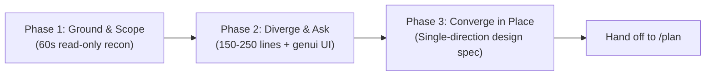

# Interactive Design and Brainstorming (`design`)

## Zero Workspace or External Mutations

Keep every repository, remote service, and local configuration untouched throughout the design session:

- Never create, edit, or delete repository files, stage commits, or change worktree state.
- Never mutate external systems. Do not open or edit GitHub issues or PRs, change Google Docs, Sheets, Slides, or Drive files, or reconfigure plugins.
- Write only to the session artifact directory (`<conversation-artifact-dir>/*.md`), the session scratch directory (`<conversation-scratch-dir>/`), and interactive UI surfaces (such as `render_a2ui`). Delete temporary query files before ending the turn, and delete `panel_*.md` files upon convergence.
- Never jump from design exploration into implementation unless the user explicitly asks for code changes in a later turn.

## Flags

| Flag | Behavior |
| :--- | :--- |
| *(none)* | Runs single-agent recon and divergence in the active session. Never spawn more than two parallel workers unprompted without asking for user approval first. |
| `--panel` | Strictly opt-in because it spawns up to 4 read-only `panel-*` workers after Phase 1 recon ([panel_divergence.md](references/panel_divergence.md)). |

## Task-Shape Triage

Match the depth and sections of the design session to the prompt before reading files or drafting prose:

| Task shape | Signal | Workflow path |
| :--- | :--- | :--- |
| Architecture or feature design | New subsystem, protocol, data model, refactor, or cross-package feature | Run all three phases: Ground, Diverge and Ask, then Converge into a Design Spec. |
| Empirical audit and redesign | Evaluating an existing workflow, skill, performance bottleneck, or corpus | Run Phase 1 metrics first (inline `Chart` when 4 or more shared-unit data points exist), then Phase 2 and Phase 3. |
| Creative, naming, or demo ideation | Naming, UX concepts, prompt experiments, or open-ended brainstorming | Run lightweight Phase 1 and Phase 2 only. Skip API reviews, schemas, rollout splits, and Phase 3 spec sections. |

## Three-Phase Workflow

### Phase 1: Ground and Scope

1. Spend up to 60 seconds grounding the problem in read-only evidence using size-routed tools:
   - Point lookups and small files (`< 350` lines) via `rg` and `fd` ([unix-cli-best-practices](../unix-cli-best-practices/SKILL.md)).
   - Symbol call graphs and blast radius via `sem` ([sem-semantic-info](../sem-semantic-info/SKILL.md)).
   - Prior pull requests, issues, and design discussions via [packrat](../packrat/SKILL.md).
   - Past transcripts, benchmark logs, or Markdown corpora via `duckdb` and [context-indexer](../context-indexer/SKILL.md).
2. Check whether the prompt bundles two or more independent designs. When it does, propose an ordering and design them one at a time instead of combining unrelated specs.
3. Challenge weak premises directly and surface the strongest counter-argument to the user's opening hunch first, with zero filler praise.
4. When given competing docs, issues, or notes, run contradiction triage before proposing options (see [design_convergence_and_ui.md](references/design_convergence_and_ui.md)):
   - Map *Competing Paths* where input artifacts pull in incompatible directions.
   - Surface *Blind Spots* omitted across all inputs, such as failure paths or callers.
   - Expose *Implicit Assumptions* that the inputs rely on without proof.
5. Ask up-front scope questions only when core boundaries, target repositories, or portability rules remain genuinely ambiguous. Render an inline `assumption_ledger` (`genui`) or use your host's question tool to check 2 to 5 inferred facts; otherwise go straight to Phase 2.
6. When Phase 1 finds 4 or more baseline metrics sharing one unit (`ms`, `tokens`, `%`, or lines), render a compact inline `Chart` (`height=190`).

### Phase 2: Diverge and Ask

Produce a scannable Phase 2 draft (`150` to `250` lines, at most `2,000` words) in `<conversation-artifact-dir>/` using [design_convergence_and_ui.md](references/design_convergence_and_ui.md):

1. When `--panel` is active, run multi-perspective divergence before drafting the artifact ([panel_divergence.md](references/panel_divergence.md)):
   - Write an unanchored brief in `<conversation-scratch-dir>/panel_brief.md` omitting candidate options A/B/C so personas explore independently.
   - Run Round 1 (2 opposing domain personas plus `panel-red` pre-mortem) and `panel-facts` codebase verification. Default to 1 round plus fact-check, offering Round 2 rebuttals and shared-premise red-teaming only on splits.
   - Drop any point backed by a `FALSIFIED` claim and act as synthesizer rather than arbiter. Surface unresolved panel splits in the Phase 2 artifact and interactive A2UI decision surface.
2. Open the artifact with an objective-isolated `At a Glance` block (`<= 80` words). State `Problem` using measurable outcomes or pain points without naming a solution mechanism, followed by user-stated `Hard Constraints` and the `Recommended Direction`.
3. Summarize the baseline with clickable `[basename](file:///...)` links:
   - List 2 to 4 `Non-Goals` covering out-of-scope work and 1 to 2 sentence dismissals of strawman options.
   - Pair them with `Anti-Goals` naming failure outcomes that disqualify a working design, such as silent fallbacks or manual migrations.
4. Settle routine, reversible defaults inline tagged `[assumed: say otherwise]` instead of turning minor details into questions. Treat only user-stated requirements and code invariants as hard constraints.
5. Rank 2 to 4 decision criteria (such as `Consistency > Latency > Complexity`) before scoring options so every criterion row in the `Tradeoff Matrix` comes from an explicit priority.
6. Present 2 to 4 viable options (or orthogonal axes) anchored against the simplest honest baseline:
   - State the baseline first, such as extending an existing module, keeping a manual step, or doing nothing.
   - Use Design-It-Twice structural contrast (such as a deep, minimal interface vs. a flexible, seamed boundary) rather than minor variations of one approach.
   - Include one `flowchart` or `sequenceDiagram` per distinct architecture ([mermaid-diagrams](../mermaid-diagrams/SKILL.md)) and one unified `Tradeoff Matrix` with the ranked criteria plus a `Deletion cost` row. Never repeat tradeoffs in prose bullets and a separate Pros/Cons table.
7. When 2 or more open decisions exist, pair the artifact link with an interactive decision surface instead of trailing prose questions:
   - When `render_a2ui` is available (`a2ui-pane`), read `genui` and call `a2ui_instructions` once per session. Treat named templates (`consequence_cards`, `comparison_matrix`, `decision_batch`) and improvised A2UI Express (`dsl` without `template`, such as axis mixers, `Tabs`, or `Slider` tuners) as co-equal peers.
   - Include a pre-checked review toggle (`runReview` = `true`) on architectural and empirical sessions; omit it for creative ideation.
   - Add a footer fast-path escape hatch (`Accept remaining defaults and converge now`) kept separate from per-question defaults (see [design_convergence_and_ui.md](references/design_convergence_and_ui.md)).
   - Use `"multipleSelection"` chips or per-axis pickers when options combine into hybrids. For more than 4 deep forks, step through one fork per turn with a `Stepper` Decision Deck (`mode: "pane"`, `replace: true`).
   - When `a2ui-pane` is unavailable, use your host's question tool (`ask_question` or `AskUserQuestion`) or a numbered chat list (`(Recommended)` first), then wait.
8. Detect premise shifts across turns. When a reply or write-in invalidates an earlier premise, flag affected downstream choices and revisit those forks. Cap resets at 2 strikes before opening a direct tie-breaker surface.
9. Keep chat replies brief: link the artifact and active UI surface (`[A2UI Pane](sidecar://a2ui-pane/a2ui-pane/)` or `<agent-embed>`) without repeating the body. On multi-turn Phase 2 sessions, append a 2-line `Settled | Open` ledger in chat (see [design_convergence_and_ui.md](references/design_convergence_and_ui.md)).

### Phase 3: Converge into a Design Spec

Once decisions arrive on an architectural or feature session, update the **same** artifact in place using the Phase 3 skeleton in [design_convergence_and_ui.md](references/design_convergence_and_ui.md):

1. Write directly as the final design without narrating brainstorm history or discarded drafts, and omit empty optional sections instead of writing `"N/A"`.
2. Promote the chosen or hybrid design to `Architecture & Component Design` and collapse rejected options into a compact `Alternatives Considered` table (`Option | Summary | Why Not Selected | Revisit If`).
3. Format `Settled Decisions` with dates and the Rational Decision Formula (*"Because [priority], we chose [design], accepting [downside]"*):
   - Record each answered fork with the priority that drove the choice and the accepted tradeoff.
   - List secondary choices left to `/plan` or the implementer under `Deferred Decisions`.
4. Fill in concrete specifications ready for `/plan`:
   - Enforce the Mechanism Rule on load-bearing steps: name the actor, inputs, exact contract or command, empty/missing/failure behavior, and ranking tie-breaks.
   - Cite a primary source (code, benchmark, or doc) for every numeric target, timeout, cap, or count, or tag it `[proposed]` or `[assumed]`.
   - Mark deltas in brownfield Mermaid diagrams with `[NEW]`, `[MODIFIED]`, and plain existing nodes plus a legend. Separate Module View (packages and interfaces) from Runtime View (processes and sequences) when both are complex.
   - Check `Data Model & API Contracts` against [canonical_api_design.md](../review-core/references/canonical_api_design.md) and elide unchanged fields with `...` on modified types instead of pasting full declarations.
   - Specify `Lifecycle, State & Failure Modes` with state, sequence, or ER diagrams and rollback behavior. Allow concise EARS invariants (`WHEN` / `WHILE` / `IF ... THEN`) for stateful designs.
   - Add `Rollout, Migration & Expected PR Split` (3 to 6 bullets) and `Verification & Benchmark Sketch` (3 to 5 bullets).
5. Run a silent stakeholder check (implementer, operator, caller, security), placing answers into their matching sections without adding a meta-checklist.
6. Run a lightweight Goldfish self-check so a fresh agent with zero chat history can draft `/plan` without guessing. Make this check thorough when `--post-design` review is unchecked, and sort every gap into three piles:
   - `Answered in repo` to check in code and fill directly.
   - `Minor (Builder Call)` to settle inline with `[assumed: say otherwise]`.
   - `User Decision` to ask as one focused question.
7. Run `analyze_prose.py` ([write-prose](../write-prose/SKILL.md)) on the converged artifact and fix any flagged AI-isms, em-dashes, complex sentences, or inline-header list overuse.
8. When `--panel` ran, cancel any backup timer, tear down `panel-*` workers, and delete temporary `<conversation-scratch-dir>/panel_*.md` files upon convergence so `/design-review --post-design` (`des-*`) runs cleanly.
9. When the review option stays enabled (or the user requests review), invoke [design-review](../design-review/SKILL.md) in `--post-design` mode:
   - Pass a `< 4 KB` `Design Briefing Packet` containing `Spec Path`, `Target Workspace`, `Core Problem & Goal`, `Hard Constraints`, `Explicit Non-Goals`, optional `Anti-Goals`, locked `Settled Decisions`, and optional `Deferred Decisions`.
   - Fold minor polish and append `## Design Review Sign-Off` when `0` `critical`/`high` findings and `< 3` items surface.
   - Render `scorecard` and `triage_matrix` when `critical`/`high` blockers or `3+` items appear so the user selects revisions before `/plan`.
10. Conclude with non-mutating next steps such as running `/plan` or probing an edge case deeper. Do not offer to edit code or open issues until the user leaves design mode.

## Relationship to Other Skills

- Use [grill-me](../grill-me/SKILL.md) for targeted alignment interviews on an existing task or mid-flight pivot when a full design exploration artifact is unnecessary.
- Use [design-review](../design-review/SKILL.md) for an evidence-capped audit of a converged spec or existing module (`--post-design` runs this after Phase 3 when checked).
- Use [plan](../plan/SKILL.md) once Phase 3 converges on a direction and you need file-level `[NEW]` / `[MODIFY]` tasks, parallel execution waves, and verification gates.
- Do not use this workflow when evaluating the read-only blast radius and migration cost of one already-chosen change rather than comparing open design alternatives.
