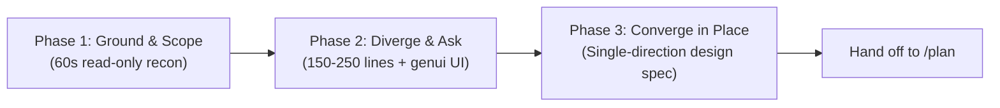

# Interactive Design and Brainstorming (`design`)

## Zero Workspace or External Mutations

Keep every repository, remote service, and local configuration untouched throughout the design session:

- Never create, edit, or delete repository files, stage commits, or change worktree state.
- Never mutate external systems. Do not open or edit GitHub issues or PRs, change Google Docs, Sheets, Slides, or Drive files, or reconfigure plugins.
- Write only to the session artifact directory (`<conversation-artifact-dir>/*.md`) and to interactive UI surfaces (such as `render_a2ui`). Delete any temporary query files in the session scratch directory (`<conversation-scratch-dir>/`) before ending the turn.
- Never jump from design exploration into implementation unless the user explicitly asks for code changes in a later turn.

## Task-Shape Triage

Match the depth and sections of the design session to the prompt before reading files or drafting prose:

| Task shape | Signal | Workflow path |
| :--- | :--- | :--- |
| Architecture or feature design | New subsystem, protocol, data model, refactor, or cross-package feature | Run all three phases: Ground, Diverge and Ask, then Converge into a Design Spec. |
| Empirical audit and redesign | Evaluating an existing workflow, skill, performance bottleneck, or corpus | Run Phase 1 metrics first (inline `Chart` when 4 or more shared-unit data points exist), then Phase 2 and Phase 3. |
| Creative, naming, or demo ideation | Naming, UX concepts, prompt experiments, or open-ended brainstorming | Run lightweight Phase 1 and Phase 2 only. Skip API reviews, schemas, rollout splits, and Phase 3 spec sections. |

## Three-Phase Workflow

### Phase 1: Ground and Scope

1. Spend up to 60 seconds grounding the problem in read-only evidence using size-routed tools:
   - Point lookups and small files (`< 350` lines) via `rg` and `fd` ([unix-cli-best-practices](../unix-cli-best-practices/SKILL.md)).
   - Symbol call graphs and blast radius via `sem` ([sem-semantic-info](../sem-semantic-info/SKILL.md)).
   - Prior pull requests, issues, and design discussions via [packrat](../packrat/SKILL.md).
   - Past transcripts, benchmark logs, or Markdown corpora via `duckdb` and [context-indexer](../context-indexer/SKILL.md).
2. Ask up-front scope questions before drafting only when core problem boundaries, target repositories, or portability constraints are genuinely ambiguous. Render an inline `assumption_ledger` (`genui`) or use your host's question tool to confirm 2 to 5 inferred facts. When the prompt and codebase already bound the problem, proceed directly to Phase 2 without a pre-draft gate.
3. When Phase 1 finds 4 or more baseline metrics sharing one unit (`ms`, `tokens`, `%`, or lines), render a compact inline `Chart` (`height=190`).

### Phase 2: Diverge and Ask

Write the design artifact in the session artifact directory (`<conversation-artifact-dir>/`) using [design_convergence_and_ui.md](references/design_convergence_and_ui.md). Keep the Phase 2 draft scannable (`150` to `250` lines, at most `2,000` words):

1. Open with an `At a Glance` block (`<= 80` words) stating the problem, hard constraints, and recommended synthesis.
2. Summarize the current baseline with clickable `[basename](file:///...)` links, then list 2 to 4 explicit `Non-Goals`. Dismiss unviable strawman options in 1 to 2 sentences under `Non-Goals` instead of giving them full option sections.
3. Present 2 to 4 viable options (or orthogonal design axes) with one `flowchart` or `sequenceDiagram` per distinct architecture ([mermaid-diagrams](../mermaid-diagrams/SKILL.md)) and **one** unified comparison table. Never repeat the same tradeoffs in both prose bullets and a separate Pros/Cons table.
4. When 2 or more open decisions exist, pair the artifact link with an interactive decision surface instead of trailing prose questions:
   - When `render_a2ui` is available (`a2ui-pane`), read `genui` and call `a2ui_instructions` once per session. Treat named templates (`consequence_cards`, `comparison_matrix`, `decision_batch`) and improvised A2UI Express (`dsl` without `template`, such as axis mixers, `Tabs`, or `Slider` tuners) as co-equal peers.
   - Use `"multipleSelection"` chips or separate per-axis pickers whenever options can combine into a hybrid.
   - For more than 4 deep forks, step through them one by one in the pane using a `Stepper` Decision Deck (`mode: "pane"`, `replace: true`).
   - When `a2ui-pane` is unavailable, use your host's question tool (`ask_question` or `AskUserQuestion`) or a numbered chat list (`(Recommended)` first), then wait.
5. Keep your chat message brief: link the artifact (and `[A2UI Pane](sidecar://a2ui-pane/a2ui-pane/)` after any pane render, or `<agent-embed>` for inline surfaces) without repeating the artifact's body.

### Phase 3: Converge into a Design Spec

Once decisions arrive on an architectural or feature session, update the **same** artifact in place using the Phase 3 skeleton in [design_convergence_and_ui.md](references/design_convergence_and_ui.md):

1. Promote the chosen or combined hybrid architecture to the primary `Architecture & Design` section.
2. Collapse rejected candidates into a compact `Alternatives Considered` table (`Option | Why Not Selected | Revisit If`) so `/plan` inherits one clean specification without dead-branch prose.
3. Move answered questions into `Settled Decisions` with dates and rationale.
4. Fill in the concrete design pieces needed before planning:
   - `Data Model & API Contracts` with concrete types, schemas, or signatures checked against [api-review](../api-review/SKILL.md).
   - `Lifecycle, State & Failure Modes` using `stateDiagram-v2`, `sequenceDiagram`, or `erDiagram` where state or schemas change, plus recovery and rollback behavior.
   - `Rollout, Migration & Expected PR Split` (3 to 6 bullets) and a 3 to 5 bullet `Verification & Benchmark Sketch`.
5. Run `analyze_prose.py` ([write-prose](../write-prose/SKILL.md)) on the converged artifact and fix any flagged AI-isms, em-dashes, complex sentences, or inline-header list overuse.
6. Conclude with non-mutating next steps tailored to the session, such as running `/plan` or exploring an edge case deeper. Do not offer to edit code or open GitHub issues directly until the user leaves design mode.

## Relationship to Other Skills

- Use [grill-me](../grill-me/SKILL.md) for targeted alignment interviews on an existing task or mid-flight pivot when a full design exploration artifact is unnecessary.
- Use [proposal-writer](../proposal-writer/SKILL.md) when writing a formal RFC or stakeholder review document for external human sign-off rather than interactive session design discovery.
- Use [plan](../plan/SKILL.md) once Phase 3 converges on a direction and you need file-level `[NEW]` / `[MODIFY]` tasks, parallel execution waves, and verification gates.
- Do not use this workflow when evaluating the read-only blast radius and migration cost of one already-chosen change rather than comparing open design alternatives.
