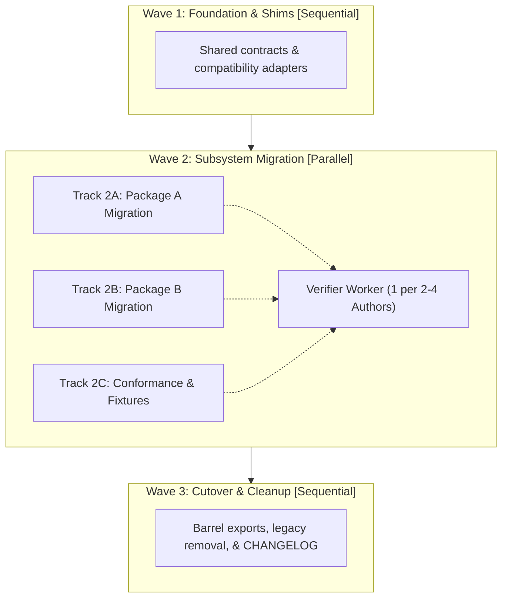

# Complex & Migration Plan Template

Use this template for architectural refactors, cross-package migrations, multi-service systems, or breaking API changes that span multiple waves and parallel execution tracks.

______________________________________________________________________

````markdown
# [Migration / Architecture Redesign Title]

[High-level overview of the redesign, motivation, target state, and expected benefits.]

## User Review Required

> [!WARNING]
> [Critical breaking changes, protocol migrations, schema updates, or deprecations that require sign-off.]

## Open Questions

> [!IMPORTANT]
> [List any open architecture questions or decisions. Recommend `/grill-me` or a `genui` `wave_sequencer` surface if wave ordering is not settled.]

## Existing System Context & Constraints

- **Repository Structure**: [Monorepo / Multi-package / Service layout]
- **Language / Runtime Versions**: [List all active runtimes across packages]
- **Affected Packages / Modules**:
  - `package-a`: [Role and scope of changes]
  - `package-b`: [Role and scope of changes]
- **Compatibility Boundaries**: [APIs, network protocols, serialized data, or wire formats that must maintain backward compatibility]
- **Explicit Non-Goals**: [Out-of-scope packages, legacy versions, or deferred follow-ups]

## Target Architecture & Wave Topology

[Describe the target architecture, modular boundaries, and wave-by-wave migration progression.]



### Orchestration & Parallel Verification Matrix

| Wave / Track | Execution Mode | Orchestrator / Role | Workspace Isolation | Owned Files / Scope | Verification Gate |
| :--- | :--- | :--- | :--- | :--- | :--- |
| **Wave 1** | Sequential | Coordinator / Single Agent | Primary workspace or base worktree | Shared interfaces & shims | `[Wave 1 typecheck + compatibility suite]` |
| **Track 2A** | Parallel (Wave 2) | `/swarm` author (`pkg-a`) or `/run-workflow` `parallel()` | `workspace: "share"` or dedicated `git worktree` | `packages/pkg_a/**` | `[Track 2A unit tests + linter]` |
| **Track 2B** | Parallel (Wave 2) | `/swarm` author (`pkg-b`) or `/run-workflow` `parallel()` | `workspace: "share"` or dedicated `git worktree` | `packages/pkg_b/**` | `[Track 2B unit tests + linter]` |
| **Wave 2 Verifier** | Parallel Critic | `/swarm` `verifier` (`1` per `2-4` authors) | `workspace: "inherit"` (read-only) | Audits Track 2A & 2B diffs and file bounds | `[Wave 2 cross-package integration gate]` |
| **Wave 3** | Sequential | Coordinator / Single Agent | Primary workspace or merged branch | Barrel exports, `CHANGELOG.md`, legacy removal | `[Full repo regression + code-review]` |

### Interface & Schema Specifications

```[language]
// New interfaces, protocol buffers, types, or schemas
```

## Migration & Execution Phases

### Wave 1: Compatibility Shims & Shared Contracts [Sequential]

[Introduce non-breaking abstractions, backward-compatibility shims, and shared interfaces so Wave 2 tracks can run in parallel without editing shared files.]

- [ ] [NEW] [path/to/shim.ext](file:///absolute/path/to/shim.ext)
  - Introduce adapter layer and shared interface definitions
- [ ] [MODIFY] [path/to/existing_contract.ext](file:///absolute/path/to/existing_contract.ext)
  - Route base contract through adapter

**Wave 1 Verification**: `[Commands to run compatibility and regression suites]`

______________________________________________________________________

### Wave 2: Core Subsystem Migration [Parallel]

[Implement the new subsystems and migrate independent packages or modules concurrently across strictly disjoint file sets.]

#### Track 2A: [Package A / Subsystem A]

- **Depends on**: Wave 1
- **Owns**: `path/to/subsystem_a.ext`, `tests/test_subsystem_a.ext`
- **Must Not Touch**: `path/to/subsystem_b.ext`, `path/to/exports.ext`, `CHANGELOG.md`

- [ ] [NEW] [path/to/subsystem_a.ext](file:///absolute/path/to/subsystem_a.ext)
  - Implement Subsystem A logic against Wave 1 contract
- [ ] [MODIFY] [tests/test_subsystem_a.ext](file:///absolute/path/to/tests/test_subsystem_a.ext)
  - Add unit and regression tests for Subsystem A

**Track 2A Verification**: `[Scoped test & static analysis command for Track 2A]`

#### Track 2B: [Package B / Subsystem B]

- **Depends on**: Wave 1
- **Owns**: `path/to/subsystem_b.ext`, `tests/test_subsystem_b.ext`
- **Must Not Touch**: `path/to/subsystem_a.ext`, `path/to/exports.ext`, `CHANGELOG.md`

- [ ] [MODIFY] [path/to/subsystem_b.ext](file:///absolute/path/to/subsystem_b.ext)
  - Switch Package B consumers to Wave 1 contract
- [ ] [MODIFY] [tests/test_subsystem_b.ext](file:///absolute/path/to/tests/test_subsystem_b.ext)
  - Update Package B test suite

**Track 2B Verification**: `[Scoped test & static analysis command for Track 2B]`

**Wave 2 Verifier & Barrier Gate**:
- Peer `verifier` confirms zero out-of-scope file edits, runs Track 2A and Track 2B test suites, and checks cognitive complexity ($\le 15$).
- Wave barrier command: `[Cross-package integration test command before Wave 3 begins]`

______________________________________________________________________

### Wave 3: Cutover, Chokepoint Wiring & Cleanup [Sequential]

[Wire public barrel exports, remove legacy shims, and update documentation and changelogs once all Wave 2 tracks have merged.]

- [ ] [DELETE] [path/to/deprecated_file.ext](file:///absolute/path/to/deprecated_file.ext)
  - Remove legacy implementation
- [ ] [MODIFY] [path/to/exports.ext](file:///absolute/path/to/exports.ext)
  - Export finalized public API surface

**Wave 3 Verification**: `[Commands to verify zero dangling references and full suite pass]`

______________________________________________________________________

## Verification Plan

### Automated Regression & Integration Tests

- Package A tests: `[test command]`
- Package B tests: `[test command]`
- Cross-package end-to-end suite: `[e2e command]`
- Static analysis & lint: `[lint command]`

### Edge Cases & Failure Scenarios

1. [Failure scenario 1, e.g. network partition during transition]
2. [Failure scenario 2, e.g. mixed version data serialization]
3. [Failure scenario 3, e.g. concurrent schema migrations]

### Performance & Complexity Audit

- Benchmark command: `[benchmark command if applicable]`
- Complexity check: Verify that new functions comply with cognitive complexity limits ($\le 15$).

## Rollback & Disaster Recovery Plan

1. **Rollback Trigger**: [Specific error rate, latency spike, or test failure that mandates aborting the rollout]
2. **Rollback Steps**: [Exact steps and commands to revert to the previous stable state without data loss]
````
