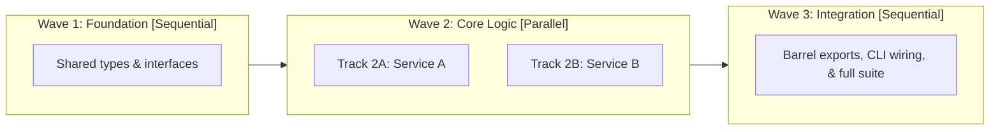

# Standard Implementation Plan Template

Use this template for multi-file features, bug fixes, or refactors. When 2 or more tracks operate on disjoint files, group them into parallel tracks between sequential foundation and integration waves (**Sandwich Wave Topology**). For strictly linear changes where every step modifies the same file, use standard `### Phase 1` / `### Phase 2` headings.

______________________________________________________________________

````markdown
# [Feature / Task Title]

[Provide a concise description of the task, background context, and the engineering objective.]

## User Review Required

> [!IMPORTANT]
> [Highlight any critical architectural decisions, potential breaking changes, or trade-offs that need user attention.]

## Open Questions

> [!NOTE]
> [List any open questions, ambiguous edge cases, or dependencies requiring clarification. If none, state "None currently blocking."]

## Codebase Context & Discovered Patterns

- **Language / Runtime**: [e.g. Python 3.11, Dart 3.7 / Flutter, TypeScript 5.4]
- **Build / Test Tooling**: [e.g. `pytest`, `flutter test`, `npm test`, `cargo test`]
- **Lint / Static Analysis**: [e.g. `ruff`, `dart analyze`, `eslint`, `mypy`]
- **Existing Abstractions to Reuse**:
  - `[Symbol / Module 1]`: [How this existing code satisfies part of the requirement]
  - `[Symbol / Module 2]`: [Existing utility or helper to follow or reuse]
- **Key Constraints & Non-Goals**: [Backward compatibility, memory limits, explicit out-of-scope items]

## Architecture & Technical Design

[Explain the proposed approach, data model changes, component interactions, and interface definitions.]



### Execution & Verification Strategy

- **Orchestration Mode**: [`Sequential` (single agent) | `/swarm` (named author + verifier workers) | `/run-workflow` (`parallel()` script)]
- **Workspace Mode**: [`inherit` | `share` (per-author working copy) | `branch` (isolated clone) | dedicated `git worktree`]
- **Verifier Ratio**: [`1` verifier worker per `2-4` parallel author tracks, or inline verification for sequential plans]
- **Shared Chokepoint Files**: [List barrel exports (`index.ts`, `lib/*.dart`, `__init__.py`), dispatch registries, or `CHANGELOG.md` isolated in Wave 1 or Wave 3 so Wave 2 tracks never collide]

### Key Interfaces & Signatures

```[language]
// Outline key interfaces, type definitions, or method signatures
```

## Phased Implementation Plan

### Wave 1: Foundation & Shared Contracts [Sequential]

Description of initial setup, shared data structures, or interface definitions that parallel tracks build against.

- [ ] [NEW] [path/to/types.ext](file:///absolute/path/to/types.ext)
  - Define `TypeName` struct/class with fields `...`
  - Implement input validation helpers

**Wave 1 Verification**: `[Command to verify Wave 1, e.g. npm run typecheck or pytest tests/unit/test_types.py]`

______________________________________________________________________

### Wave 2: Core Implementation [Parallel]

Independent implementation tracks touching strictly disjoint file sets (`validate_plan.py` enforces zero file overlap across tracks in the same wave).

#### Track 2A: [Subsystem / Component A]

- **Depends on**: Wave 1
- **Owns**: `path/to/service_a.ext`, `tests/test_service_a.ext`
- **Must Not Touch**: `path/to/service_b.ext`, `path/to/index.ext`

- [ ] [MODIFY] [path/to/service_a.ext](file:///absolute/path/to/service_a.ext)
  - Implement `process_request()` using `[reused_helper]`
  - Add error handling for edge cases
- [ ] [NEW] [tests/test_service_a.ext](file:///absolute/path/to/tests/test_service_a.ext)
  - Add unit tests for `process_request()`

**Track 2A Verification**: `[Scoped test & lint command for Track 2A, e.g. pytest tests/test_service_a.ext]`

#### Track 2B: [Subsystem / Component B]

- **Depends on**: Wave 1
- **Owns**: `path/to/handler_b.ext`, `tests/test_handler_b.ext`
- **Must Not Touch**: `path/to/service_a.ext`, `path/to/index.ext`

- [ ] [NEW] [path/to/handler_b.ext](file:///absolute/path/to/handler_b.ext)
  - Implement request dispatching for Component B
- [ ] [NEW] [tests/test_handler_b.ext](file:///absolute/path/to/tests/test_handler_b.ext)
  - Add unit tests for handler dispatching

**Track 2B Verification**: `[Scoped test & lint command for Track 2B, e.g. pytest tests/test_handler_b.ext]`

**Wave 2 Verifier & Barrier Gate**:
- Peer `verifier` checks that Track 2A and Track 2B stayed within their owned file boundaries and passed track-local tests.
- Wave barrier command: `[Combined test & static analysis command before Wave 3 starts]`

______________________________________________________________________

### Wave 3: Integration, Exports & CLI Surface [Sequential]

Wire parallel tracks into shared chokepoint files, entry points, and documentation.

- [ ] [MODIFY] [path/to/index.ext](file:///absolute/path/to/index.ext)
  - Export symbols from Track 2A and Track 2B
  - Register handlers in central dispatcher

**Wave 3 Verification**: `[Command to run integration test suite, e.g. pytest tests/integration/]`

______________________________________________________________________

## Verification Plan

### Automated Tests

- Run unit tests: `[exact test command, e.g. pytest -v tests/]`
- Run linter / typechecker: `[exact command, e.g. ruff check .]`
- Run full regression suite: `[exact command, e.g. pytest]`

### Edge Cases to Validate

1. [Edge case 1, e.g. empty input, null values, or timeout handling]
2. [Edge case 2, e.g. concurrent access or duplicate IDs]
3. [Edge case 3, e.g. error propagation when downstream service is unavailable]

### Manual Verification

1. [Step 1: Run application command with sample arguments]
2. [Step 2: Inspect output or verify expected state change]

## Rollback & Risk Mitigation

- **Breaking Changes**: [None, or details of breaking API changes and migration shim]
- **Rollback Strategy**: [How to cleanly revert if issues arise in production or review]
````
