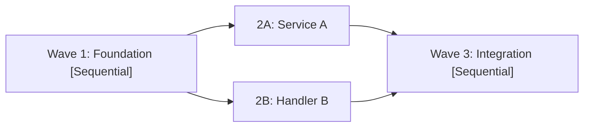

# Standard Implementation Plan Template

Use this template for multi-file features, bug fixes, or refactors. When 2 or more tracks operate on disjoint files, group them into parallel tracks between sequential foundation and integration waves (**Sandwich Wave Topology**). For strictly linear changes where every step modifies the same file, use `### Phase 1` and `### Phase 2` headings.

## Two-Layer Prose Rule

Every plan has two prose layers checked by `validate_plan.py`:

- **Brief layer** (`## At a glance`, the `### Commits` or `### PRs` table, `## User Review Required`, `## Open Questions`, and `## Decisions`): written for the human reader under strict [write-prose](../../write-prose/SKILL.md) rules. The five `At a glance` bullets must total 180 words or fewer. Sentences across the brief sections must average 20 words or fewer.
- **Execution layer** (`## Context`, `## Design`, `## Phased Implementation Plan`, `## Verification Plan`, `## Landing`, and `## Rollback & Risk Mitigation`): written for agents using tables and checklists. Follow `write-prose` vocabulary rules (plain words, no AI-isms, no em-dashes, and "Recommended" instead of "default"), while allowing longer sentences and dense code spans.

See [post_plan_ui.md](post_plan_ui.md) for rendering the post-plan worksheet, overview pane, progress board, and landing gate.

______________________________________________________________________

````markdown
# [Feature / Task Title]

## At a glance

- **Goal:** [One short sentence stating the outcome.]
- **Shape:** [3 waves, 2 parallel tracks, and 3 commits or PRs.]
- **Decisions needed from you:** [1 (Q1 under Open Questions), or "none."]
- **Biggest risk:** [One short sentence naming the main risk and its mitigation.]
- **Not doing:** [Explicit non-goals in one short line.]



### PRs

| # | Repo | PR / Commit | Wave |
| ---: | :--- | :--- | :--- |
| 1 | [repo] | `feat(scope): add shared types and contracts` | 1 |
| 2 | [repo] | `feat(scope): implement service A and handler B` | 2 (2A, 2B) |
| 3 | [repo] | `feat(scope): wire exports and CLI entry point` | 3 |

## User Review Required

> [!IMPORTANT]
> [State any breaking change, trade-off, or risk that needs user review. Keep sentences under 20 words on average.]

## Open Questions

### Q1: [Short question title?]
- (Recommended) A: [Recommended choice.] Consequence: [Concrete effect of choosing A.]
- B: [Alternative choice.] Consequence: [Concrete effect of choosing B.]

<!-- When no open questions remain, replace the Q<n> blocks above with:
None currently blocking.
-->

## Decisions

- **Q0 (YYYY-MM-DD):** A. [Recorded answer in the agent's own words.]

## Context

- **Language / Runtime**: [e.g. Python 3.12, Dart 3.7 / Flutter, TypeScript 5.6]
- **Build / Test Tooling**: [e.g. `pytest`, `flutter test`, `npm test`, `cargo test`]
- **Lint / Static Analysis**: [e.g. `ruff`, `dart analyze`, `eslint`, `mypy`]
- **Existing Abstractions to Reuse**:
  - `[Symbol / Module 1]`: [How this existing code satisfies part of the requirement]
  - `[Symbol / Module 2]`: [Existing utility or helper to reuse]
- **Key Constraints & Non-Goals**: [Backward compatibility, memory limits, explicit out-of-scope items]

## Design

[Explain the proposed approach, data model changes, component interactions, and interface definitions.]

### Key Interfaces & Signatures

```[language]
// Outline key interfaces, type definitions, or method signatures
```

### Execution & Verification Strategy

| Setting | Value |
| :--- | :--- |
| Orchestration | [`Sequential` (single agent) \| `/swarm` (named author + verifier workers) \| `/run-workflow` (`parallel()` script)] |
| Workspaces | [`inherit` \| `share` (per-author working copy) \| `branch` (isolated clone) \| dedicated `git worktree`] |
| Verifier ratio | [`1` verifier worker per `2-4` parallel author tracks, or inline verification for sequential plans] |
| Chokepoints | [Barrel exports (`index.ts`, `lib/*.dart`, `__init__.py`) or registries isolated in Wave 1 or Wave 3] |
| Model tiers | [Capable model (`pro` / `self`) for architecture and coordination; fast tier for bounded tracks] |

## Phased Implementation Plan

### Wave 1: Foundation & Shared Contracts [Sequential]

- **Model tier**: [e.g. Claude Fable 5.1 High]

Define shared data structures and interfaces that parallel tracks build against.

- [ ] [NEW] [types.ext](file:///absolute/path/to/types.ext)
  - Define `TypeName` struct or class with fields `...`
  - Implement input validation helpers

**Wave 1 Verification**: `[Command to verify Wave 1, e.g. npm run typecheck or pytest tests/unit/test_types.py]`

______________________________________________________________________

### Wave 2: Core Implementation [Parallel]

Independent implementation tracks touching strictly disjoint file sets (`validate_plan.py` enforces zero file overlap across tracks in the same wave).

#### Track 2A: [Subsystem / Component A]

- **Depends on**: Wave 1
- **Model tier**: [e.g. Gemini Pro Next (`auto`)]
- **Owns**: `path/to/service_a.ext`, `tests/test_service_a.ext`
- **Must Not Touch**: `path/to/handler_b.ext`, `path/to/index.ext`

- [ ] [MODIFY] [service_a.ext](file:///absolute/path/to/service_a.ext)
  - Implement `process_request()` using `[reused_helper]`
  - Add error handling for invalid inputs
- [ ] [NEW] [test_service_a.ext](file:///absolute/path/to/tests/test_service_a.ext)
  - Add unit tests for `process_request()`

**Track 2A Verification**: `[Scoped test & lint command for Track 2A, e.g. pytest tests/test_service_a.ext]`

#### Track 2B: [Subsystem / Component B]

- **Depends on**: Wave 1
- **Model tier**: [e.g. Gemini Pro Next (`auto`)]
- **Owns**: `path/to/handler_b.ext`, `tests/test_handler_b.ext`
- **Must Not Touch**: `path/to/service_a.ext`, `path/to/index.ext`

- [ ] [NEW] [handler_b.ext](file:///absolute/path/to/handler_b.ext)
  - Implement request dispatching for Component B
- [ ] [NEW] [test_handler_b.ext](file:///absolute/path/to/tests/test_handler_b.ext)
  - Add unit tests for handler dispatching

**Track 2B Verification**: `[Scoped test & lint command for Track 2B, e.g. pytest tests/test_handler_b.ext]`

**Wave 2 Verifier & Barrier Gate**:
- Peer `verifier` checks that Track 2A and Track 2B stayed within their owned file boundaries and passed track-local tests.
- Wave barrier command: `[Combined test & static analysis command before Wave 3 starts]`

______________________________________________________________________

### Wave 3: Integration, Exports & CLI Surface [Sequential]

- **Model tier**: [e.g. Claude Fable 5.1 High]

Wire parallel tracks into shared chokepoint files, entry points, and documentation.

- [ ] [MODIFY] [index.ext](file:///absolute/path/to/index.ext)
  - Export symbols from Track 2A and Track 2B
  - Register handlers in central dispatcher

**Wave 3 Verification**: `[Command to run integration test suite, e.g. pytest tests/integration/]`

______________________________________________________________________

## Verification Plan

### Automated Tests

- Run unit tests: `[exact test command, e.g. pytest -v tests/]`
- Run linter and typechecker: `[exact command, e.g. ruff check .]`
- Run full regression suite: `[exact command, e.g. pytest]`

### Edge Cases

1. [Edge case 1, e.g. empty input, null values, or timeout handling]
2. [Edge case 2, e.g. concurrent access or duplicate IDs]
3. [Edge case 3, e.g. error propagation when downstream service is unavailable]

### Manual Verification

1. [Step 1: Run application command with sample arguments]
2. [Step 2: Inspect output or verify expected state change]

## Landing

1. Run `/code-review --fast` on the full diff and fix blocker or major findings.
2. Commit changes with `commit-changes` matching the `### PRs` or `### Commits` table.
3. Open or update pull requests with `write-pr-description` or `ship-it`.

## Rollback & Risk Mitigation

- **Breaking Changes**: [None, or details of breaking API changes and migration shim]
- **Rollback Strategy**: [How to revert cleanly if issues arise in review or production]
````
